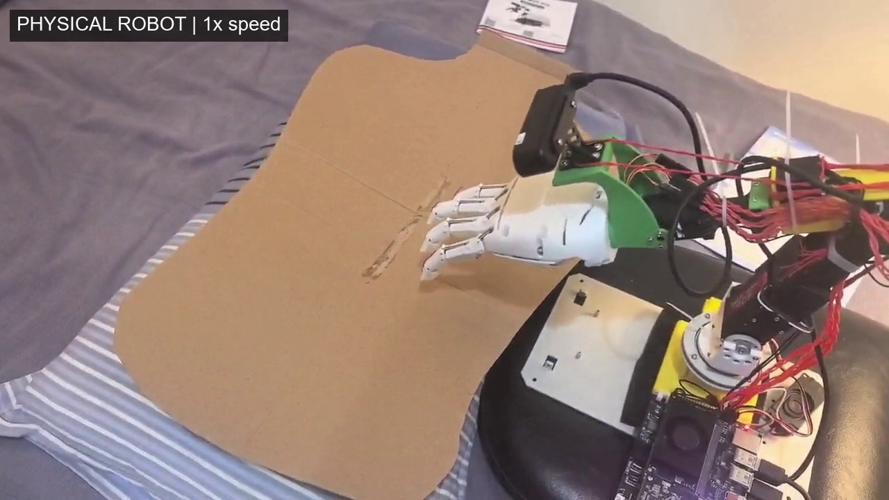
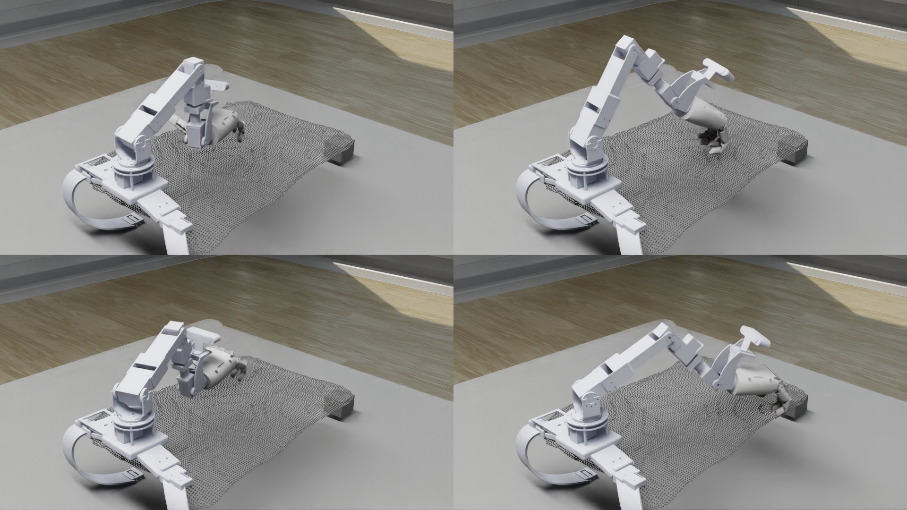
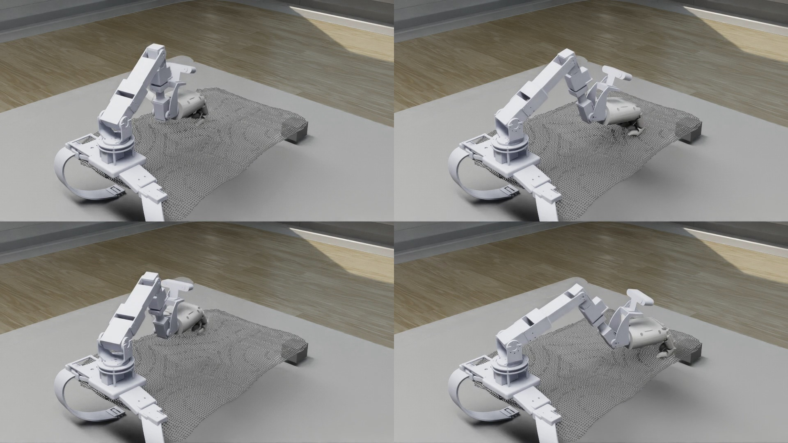

# CoScratch

Coordinated robotic scratching with a five-joint arm and a coupled four-finger hand. This repository contains the geometric scratching controller and the final learned action policy used in the project.

## Contents

| Directory | Purpose |
| --- | --- |
| `coscratch/` | Geometric planning, staggered finger motion, withdrawal and return, robot descriptions and meshes |
| `act/` | Frozen recurrent action policy, learned withdrawal expert, normalization, coupled-finger mapping and offline tests |
| `docs/` | Model description, environment requirements and source identities |

Cloud orchestration, reinforcement-learning experiments, the mobile app and intermediate checkpoints are outside this release.

## Physical demonstration

[](https://github.com/yibai100-hub/CoScratch/raw/refs/heads/main/media/physical_robot_motion_1x_pauses_4x.mp4)

[Watch or download the video](https://github.com/yibai100-hub/CoScratch/raw/refs/heads/main/media/physical_robot_motion_1x_pauses_4x.mp4). Motion is shown at **1x real-time speed**; selected low-motion pauses are shown at **4x**. No text overlays are added. The complete chronological sequence is retained. The source recording is 60.27 seconds; the edited video is approximately 52.03 seconds. Audio uses the corresponding segment speeds. [Edit timings and source hash](media/physical_motion_1x_edit.json) are provided for traceability.

This user-provided physical recording illustrates observed behavior; it is not a quantitative contact-force or generalization evaluation.

## Isaac Sim demonstrations

| Expert plan replay | Frozen ACT policy |
| --- | --- |
| [](https://github.com/yibai100-hub/CoScratch/raw/refs/heads/main/media/expert_2x2.mp4) | [](https://github.com/yibai100-hub/CoScratch/raw/refs/heads/main/media/act_2x2.mp4) |

Fresh native PhysX recordings at four selected points: top-left **5367 (31.4 cm)**, top-right **5839 (34.1 cm)**, bottom-left **6162 (36.0 cm)**, bottom-right **6735 (39.6 cm)** from the robot base. The same layout is used in both videos. Each tile contains only the third-person viewport. Playback follows simulation time, not host wall-clock time; shorter clips hold their final frame. No speed or interface overlays are added.

These are curated demonstrations from the previously tested training-set cohort, not a held-out evaluation or an overall success-rate estimate. All four expert replays completed. Each ACT recording contains two model-labelled wave/curl intervals with measured motion in all four fingers, no stop event, and a passing final Home diagnostic. Existing depth errors remain outside that action-flow criterion. Back collision remains disabled in this demo scene; geometric distance does not establish contact force or scratching effectiveness. See [recording results and limitations](media/simulation_video_review.json).

## Offline validation

The recorded local environment uses Python 3.11.15, PyTorch 2.7.0+cu128, NumPy 1.26.0 and SciPy 1.15.3. Use a separate environment rather than replacing an existing robot installation.

```sh
python -m pip install -r act/requirements-pc.txt
python act/validate_pc.py
```

The tests check model identities, replay recorded simulation observations and exercise a local mock gateway. Reports are written to `act/reports/`. They do not connect to a robot or execute a new PhysX simulation.

## Geometric controller in Isaac Sim

Use Isaac Sim 5.1 on Windows. Load the matching robot scene, with robot prim `/World/robotnew_with_aero_hand_right` and the back-surface objects expected by the controller.

1. Stop the timeline and execute `coscratch/configure_hand.py`.
2. Check that hand initialization completes.
3. Start the timeline and execute `coscratch/controller.py`.

Execute the files by path so that `__file__` resolves correctly:

```python
import runpy
runpy.run_path('/absolute/path/to/CoScratch/coscratch/configure_hand.py', run_name='__main__')
# Run separately after initialization and starting the timeline:
runpy.run_path('/absolute/path/to/CoScratch/coscratch/controller.py', run_name='__main__')
```

The robot descriptions and 28 referenced meshes are included. The complete USD scene and external scene materials are not included. An empty scene is insufficient. The renamed controller has passed syntax and implementation-comparison checks, but has not yet been rerun in PhysX. See [environment and scene requirements](docs/environment.md).

## Learned policy

The final model uses 64 input features, predicts 24 action steps and executes a 24-step prefix. Recurrent memory updates every 12 control steps. A learned router selects between the base action branch and a withdrawal expert. The model also predicts task phase.

The checkpoint is `act/weights/final.pt`:

```text
SHA-256: 2b8e8421ffabd90925a69faf7ed55443a131c6689f8bc2983830cccbd577987c
```

Use the checkpoint together with its model definition, normalization, joint order and coupled-finger mapping. See the [model description](docs/model.md) and [inference package guide](act/README.md).

## Scope and limitations

This release supports method inspection and numerical replay. It does not establish success at arbitrary targets or back poses. Reference surface distance is not contact force; a completed program or Home return alone does not establish effective or safe scratching.

The physical J2 joint and four finger actuators do not provide position feedback. The deployment interface distinguishes command estimates from measured feedback. Device addresses, credentials and active hardware bindings are not distributed. Scanning, language interaction, the mobile app and hardware services belong to the separate system-integration layer.

## Provenance and licensing

The original development files remain archived. Public entry points use descriptive names; internal compatibility identifiers and source hashes are retained for traceability. Third-party robot descriptions, meshes and dependencies retain their respective rights. A repository-wide redistribution license has not been assigned; inclusion here does not grant additional rights to third-party assets. Their licensing review remains outstanding.

This is an inference and controller release, not a complete from-scratch training reproduction. Training scripts, dataset release terms, the full scene, formal paper metadata and a fresh native controller regression remain separate release tasks.
